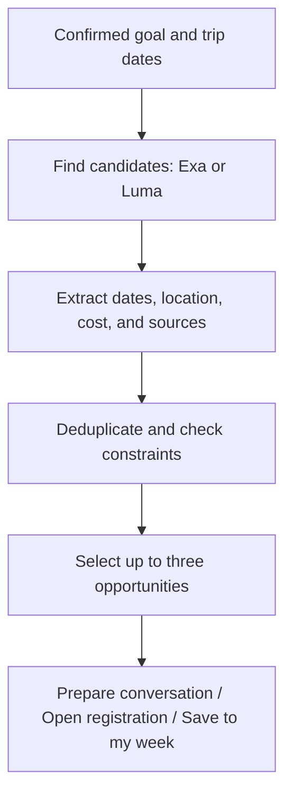

# SF Sidekick: current codebase and implementation priorities

**Review date:** October 24, 2026 · San Francisco  
**Reviewed branch and commit:** `main` at `c339072`  
**Scope:** Application source, tests, configuration, requirements, implementation plan, and existing verification records.  
**Verification limit:** Static review. The application and tests were not run during this review because dependencies were not installed in this checkout. Existing verification records are identified separately below.  
**Document status:** Assessment and recommendations, not an implementation commitment. Creating this document does not change application behavior.

The three priorities—QR exchange, event discovery, and calendar sharing—can be built on the current application without replacing its architecture. The repository already provides persistent accounts, a structured conversational profile, and a real read-only Google Calendar integration. The missing work connects that foundation to events, other people, and a useful weekly plan.

## 1. Product understanding

SF Sidekick should help someone make the most of a short stay in San Francisco: understand what they want to accomplish, find relevant opportunities, help them connect with people, and organize the resulting actions from their phone.

A representative journey:

> You arrive in SF looking for design partners. Sidekick suggests events related to your product and schedule. You save two to your week. At one event, you meet someone and exchange profiles through a QR code. You decide to meet again. Sidekick finds a common time, books with permission, and keeps track of the next step.

This fits the hackathon's theme of personal agents that take useful action in San Francisco, including coordination and follow-up. The [event page](https://luma.com/0rycyhrt) emphasizes working projects and practical use beyond the hackathon.

## 2. What the application currently does

The implemented user journey ends at onboarding completion:

1. **Create an account or sign in.** Register with email and password, restore data from another browser, and sign out.
2. **Build a profile through conversation.** OpenAI interprets free-form messages and extracts name, experience, what the person can offer, goal, trip dates, and some preferences. It asks about missing information and processes corrections.
3. **Review and confirm the profile.** The draft is persisted, but it does not replace the confirmed profile until the user selects the confirmation action.
4. **Connect Google Calendar.** A real OAuth flow identifies the connected account and lets the user select calendars.
5. **Check occupied time during the trip.** The backend retrieves busy intervals and requires successful results from every selected calendar.
6. **Show “Onboarding complete.”** This requires both a confirmed profile and a current availability check. There is no subsequent events, contacts, or agenda screen yet.

The main page always redirects to registration or onboarding. This is the current functional boundary, even though the implementation plan describes a much larger product.

## 3. Codebase map

| Area | Current responsibility |
| --- | --- |
| [Application pages](src/app) | Registration, login, and onboarding routes. `/` and `/es` redirect into the current flow. |
| [Components](src/components) | Forms, conversation, profile preview, account controls, and the Google Calendar card. |
| [Domain models](src/lib/domain) | Zod definitions and validation for profiles, goals, dates, messages, and calendar states. |
| [API routes](src/app/api) | Authenticate requests, validate input, and call server services. |
| [OpenAI onboarding](src/lib/server/onboarding-model.ts) | Sends the draft and recent messages to the model; receives a structured updated draft and conversational reply. |
| [Calendar service](src/lib/server/calendar-service.ts) | Connection, sync, selection, disconnection, and availability freshness. |
| [Google adapter](src/lib/server/google-calendar.ts) | OAuth requests, calendar listing, busy-time retrieval, and token renewal. |
| [Persistence](src/lib/server/store.ts) | SQLite storage for accounts, sessions, profiles, conversations, accepted operations, and Google connections. |
| [Tests](tests) | Domain, service, persistence, browser, and optional live OpenAI checks. |

The stack is Next.js, React, TypeScript, Zod, SQLite, and the official OpenAI SDK. Frontend and backend belong to the same application.

### Existing mechanisms worth preserving

- **Draft and confirmed profile separation.** Conversation edits do not silently change the active profile.
- **Revision checks.** An older browser tab cannot overwrite newer state.
- **Idempotency.** Retrying an accepted operation returns its stored result without duplicating its effects.
- **Session-derived ownership.** A client cannot freely choose another user to modify.
- **Server-side encrypted Google tokens.** Provider credentials stay outside the UI.
- **Explicit errors.** A failed calendar lookup does not become an empty calendar.

These mechanisms are particularly useful for invitations and bookings.

### Current profile capabilities and limits

The profile stores:

- Name and biography.
- Experience and what the person can offer, expressed as text.
- One primary goal.
- Trip dates in San Francisco.
- Additional commitments.
- Optional volunteered meeting-time preferences.
- Budget and preferred meeting format.

The supported goal types are seeking a role, hiring an engineer, finding customers or design partners, and finding collaborators. A goal can be changed and saved as a new context revision. There are no recommendations to recalculate yet.

There are no dedicated fields for interests, company, professional links, accommodation area, travel constraints, or notification preferences. Some information could appear in the biography, but that is different from having structured fields for filtering and scheduling. See [context.ts](src/lib/domain/context.ts).

### Current model capabilities and limits

The model is an onboarding assistant. Its request includes no tools, and its instructions explicitly say it cannot find participants or book meetings. Turning it into the intended agent requires search and proposal operations; expanding the prompt alone would not provide those capabilities.

## 4. What the Google Calendar implementation provides

The existing integration is a useful foundation. It currently supports:

- One connected Google account per profile.
- Multiple selected calendars from that account.
- Busy-time queries over the trip dates.
- Token renewal and disconnection.
- Detection of expired availability, insufficient permissions, and calendar failures.

Availability is considered fresh for five minutes. The page checks status periodically while visible and when it regains focus or connectivity. This is not continuous background synchronization.

The integration does not currently:

- Fetch event titles, descriptions, or attendees.
- Display a visual agenda of Google events.
- Calculate common meeting times between two people.
- Share information with another user.
- Create, cancel, or reschedule meetings.

The current OAuth scopes cover availability and the calendar list. Reading event details and writing events require additional capabilities and permissions. See [Google Calendar scopes](https://developers.google.com/workspace/calendar/api/auth).

### Existing verification evidence

The [README](README.md) records a real connection and availability check with one Google account. That live range contained no busy intervals; occupied intervals and several failure conditions are covered through simulated provider responses.

The repository also contains [live onboarding verification records](docs/verification/onboarding-natural-2026-10-24.json). These are useful evidence, but they do not replace testing the new journey with two phones and two accounts.

No new runtime verification was performed during this review.

## 5. Requirements compared with the implementation

| Requirement | Current state | Required extension |
| --- | --- | --- |
| Accounts and persistent personal data | Implemented | Email verification and password recovery remain absent. |
| Editable profile, goal, and dates | Implemented | Add fields when a specific use case needs them. |
| Connect Google and select calendars | Implemented | Reuse the existing connector. |
| QR exchange | Absent | Invitations, shareable fields, acceptance, and revocation. |
| Find events through Luma or Exa | Absent | Provider adapter, normalization, and result storage. |
| Up to three recommendations with sources | Absent | Filters, evaluation, and opportunity cards. |
| Share availability | Absent | Permissions between users and a date-limited view. |
| Find common meeting times | Absent | Computation over busy intervals, preferences, and buffers. |
| Create meetings in both calendars | Absent | Write permission, booking state, and failure recovery. |
| Own weekly agenda | Absent | Persistent plan items and a chronological screen. |
| Assisted event registration | Absent | Prepared information and the official form link, with a separate registration state. |
| Automatic matching and introductions | Absent | Voluntary visibility, proposals, and bilateral acceptance. |
| Notes, follow-up, and notifications | Absent | New entities; scheduled work for proactive behavior. |
| NFC, proximity interaction, and native app | Absent | Later exploration independent of the first web journey. |

The research report in `exa-results` is not an Exa integration in the application.

## 6. Priority one: QR-based exchange

Start with a Sidekick invitation that survives registration and sign-in. This is the most straightforward of the three priorities to add without deeply changing existing functionality.

### Proposed journey

1. Person A selects **Share my profile** and chooses the visible fields.
2. Sidekick generates an invitation link and QR code.
3. Person B scans it and sees the information A chose to share.
4. B signs in or registers and chooses what to share back.
5. The two users become connected and can share availability or propose a meeting.

The QR should contain a link with a random invitation token. The server stores its owner, scope, expiration, and status. Personal data and provider credentials do not need to be embedded in the QR.

### Specific integration points

- **Preserve the invitation through authentication.** Login and Google OAuth currently return to `/onboarding`. The pending invitation must survive these redirects.
- **Reference stable users.** Connections should use persistent user IDs, not browser cookies, which rotate when connecting Google or signing in again.

Profile sharing, availability sharing, and booking authorization should remain separate permissions. A can approve selected profile fields when generating the QR; B chooses their own fields when responding. Each owner controls additional private information.

Automatic people recommendations are not a prerequisite. QR already identifies two people who met and want to continue. Future automatic matching can reuse the same connection and consent flow.

### Phone testing dependency

Both phones need an accessible application URL. Current development and start commands bind to `127.0.0.1`. A shared HTTPS domain and the corresponding registered Google callback are needed for the intended phone journey.

## 7. Priority two: event discovery

The recommended first implementation is Exa, with Luma supported later behind the same provider contract. This is an engineering recommendation based on the current code: there is already a backend and structured extraction, but no MCP client or Luma OAuth integration.

| Option | Fit |
| --- | --- |
| **Exa API** | Web search with URLs and content; supports domain restrictions. Event facts still require validation. |
| **Luma MCP** | Documents discovery by keyword, location, and date range. Requires compatible MCP transport and authentication integration. |
| **Luma REST** | Oriented toward event and calendar management; requires Plus and calendar-scoped keys. Do not assume it is a global discovery API. |

Sources: [Exa Search](https://exa.ai/docs/reference/search), [Luma MCP](https://help.luma.com/p/mcp), and [Luma API](https://docs.luma.com/reference/getting-started-with-your-api).

Luma MCP does offer discovery without Plus. Connecting it to a development assistant, however, does not automatically integrate it into Sidekick.

### Proposed pipeline

### Data quality rules

- Event dates and page publication dates are different. Exa's documented publication-date filters do not establish when an event takes place. See the [search reference](https://exa.ai/docs/reference/search).
- A hidden address does not support a travel-time calculation.
- An unknown price does not establish compliance with a strict budget.
- A page mentioning someone does not establish their attendance.
- A failed search must retain an error state.

Every result should retain its source, checked time, and the profile revision used to evaluate it. Changing the goal should recalculate recommendations. Events the user already selected should remain in their plan until they choose to change them.

Include **paste an event URL** as an input path. It can reuse the normalizer and lets users bring in opportunities search missed.

## 8. Priority three: calendar sharing and coordination

Start with shared availability inside Sidekick. This solves a useful case without immediately importing all Google event details.

A first version could offer:

> Share my available meeting times from Monday through Friday with this person.

The backend checks the authorized accounts and returns availability or common slots according to the granted scope. This does not require giving the other person general access to the owner's Google calendar.

### Three concrete changes needed

1. **Separate calendars used for conflict checking from calendars shared with another user.** A work calendar may need to block a booking without exposing its occupied intervals to the other person.
2. **Do not reuse the current aggregate snapshot indiscriminately.** Current code merges all selected calendars' busy intervals into one list. Sharing a subset requires querying that subset or retaining results per calendar. See [googleBusy](src/lib/server/google-calendar.ts).
3. **Allow an explicit query range.** Current synchronization uses dates from the onboarding draft. An invitation or meeting should use the range its participants authorized. See [calendarStatus](src/lib/server/calendar-service.ts).

### Common-time calculation

Calculate common times in code:

- Intersect allowed meeting windows.
- Subtract calendar busy intervals and additional commitments.
- Apply meeting duration and buffers.
- Return a small number of valid options.

A free calendar does not mean a person wants meetings at any hour.

For **selected event sharing**, begin with events saved in Sidekick's own plan. Sharing details of existing Google events requires event retrieval and additional permission.

### Booking in both calendars

Booking is a larger extension. The existing implementation plan proposes a dedicated “SF Sidekick” calendar per participant, with two entries linked to one logical meeting. The `calendar.app.created` scope supports managing app-created secondary calendars. See [Google scopes](https://developers.google.com/workspace/calendar/api/auth).

The implementation needs to retain:

- Both participants' booking consent.
- Stable event IDs.
- State for each calendar.
- Retry and reconciliation results.

After creating the entries, read them back to verify the outcome. Google provides [event creation](https://developers.google.com/workspace/calendar/api/v3/reference/events/insert) and [event retrieval](https://developers.google.com/workspace/calendar/api/v3/reference/events/get).

One write can succeed while the other fails. The app must represent that partial result and recover without duplicating meetings. This is why bilateral booking has greater complexity than QR exchange or a shared availability view.

## 9. A dynamic mobile experience

Add a persistent agenda and an assistant with concrete operations. Give the user three main destinations:

- **My week:** selected events, meetings, commitments, and next steps.
- **Opportunities:** recommended events and connections with people.
- **Profile:** goal, preferences, Google Calendar, and permissions.

Keep QR sharing easy to reach. The assistant can support requests such as “find something for tomorrow,” “add this event,” or “find a time with this person” from those views.

Different use cases can share a small set of entities: events, connections, meetings, plan items, and next steps. Employment, hiring, and design-partner scenarios mainly change the goal and the explanation of relevance.

Keep onboarding as a separate module. The new assistant should read confirmed context and call concrete services. Changes should pass through the same validations and permissions as actions triggered by UI buttons.

## 10. Extending the application with limited disruption

Most work can be additive: new routes, services, and tables for invitations, sharing permissions, events, recommendations, agenda items, and meetings.

The more sensitive changes are concentrated in:

- Navigation after sign-in and OAuth.
- Availability queries and their date ranges.
- Additional Google capabilities and permissions.

There is no immediate need to replace the framework or database for a small cohort. The current SQLite architecture requires one application process and persistent storage.

Profile extensions should preserve existing records. Stored JSON is currently validated against strict schemas, so adding required fields without a compatible migration would risk breaking older data.

## 11. Suggested sequence for two people over one month

These are proposed milestones, not a guarantee that every feature will fit the available time.

| Stage | Useful outcome |
| --- | --- |
| **Week 1** | QR invitation, continuity through registration, connection between two users, and profile-sharing permissions. Test with real participants. |
| **Week 2** | Real event discovery, up to three justified recommendations, and saving choices to “My week.” |
| **Week 3** | Shared availability and common times. Enable booking when verification, cancellation, and partial-failure recovery work. |
| **Week 4** | Notes and next steps, repeated phone testing, and fixes for the main abandonment points. |

One person can own QR, connections, and calendar coordination. The other can own discovery, recommendations, and the agenda. Agree on shared contracts first to avoid incompatible concurrent changes.

For the nearest demo, prioritize **two phones exchanging profiles through QR, showing common times, and retaining a plan with real events**. Add bilateral booking when that journey has been verified.

## 12. Decisions to settle before implementation

The remaining immediate decisions are:

- Which fields the QR shares by default.
- What “share calendar” means in the first release.
- Which event provider to integrate first.
- Which completed action the demo will show.

The proposed starting choices are **user-selected profile fields, date-limited availability sharing, Exa as the first event source, and a persistent plan with coordination between two people**.

The broader requirements remain available in [SF-Sidekick-Requirements.md](SF-Sidekick-Requirements.md), and the detailed future design remains in [SF-Sidekick-Implementation-Plan.md](implementation-plan.md). Neither document should be interpreted as evidence that unimplemented features already exist.
